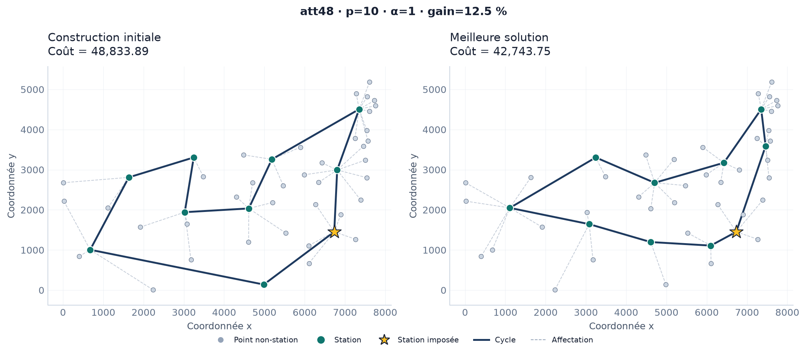
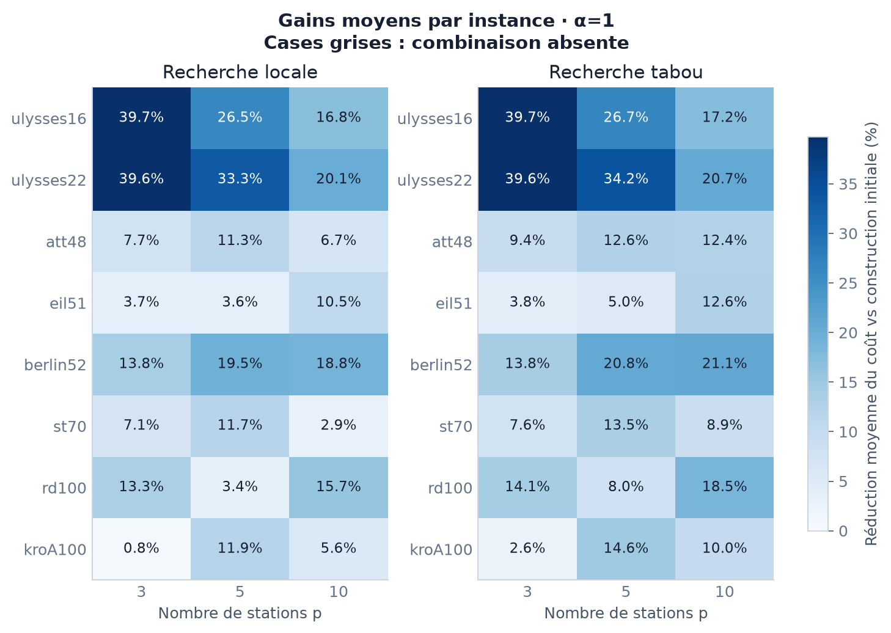

# Ring-Star : optimiser une ligne de transport circulaire

Projet Python de recherche opérationnelle consacré au **problème Ring-Star**, ou problème de l’anneau-étoile. L’objectif est de choisir des stations parmi un ensemble de lieux, de les relier par une ligne circulaire et de limiter les distances d’accès des points non desservis directement.

Le projet compare une **heuristique constructive**, une **recherche locale**, une **recherche tabou** et une **résolution exacte par programmation linéaire en nombres entiers** avec PuLP/CBC. Il comprend des expériences reproductibles, des exports de solutions et des visualisations.

Le sujet est issu d’une SAÉ d’optimisation de Sup Galilée, Université Sorbonne Paris Nord. L’[énoncé](docs/enonce_sae.pdf) et la [spécification mathématique](docs/specification.md) sont disponibles dans le dépôt.

## Le problème étudié

À partir de `n` points et d’un nombre de stations `p` fixé, il faut :

1. sélectionner exactement `p` stations parmi les points disponibles ;
2. construire un cycle simple passant par toutes les stations ;
3. affecter chaque point non-station à sa station la plus proche.

Le premier point est imposé comme station. Le coût à minimiser est :

$$
C = \alpha\,L_{\mathrm{cycle}} + \sum_{i\notin S} d\bigl(i,a(i)\bigr)
$$

`S` désigne l’ensemble des stations, `a(i)` la station affectée au point `i`, et `d` la distance euclidienne. Le poids `alpha` règle l’importance de la longueur du cycle par rapport aux trajets d’accès. Les paramètres vérifient `3 <= p <= n` et `0 <= alpha <= 10`.

Le compromis est le suivant : rapprocher les stations peut raccourcir la ligne, mais augmenter la marche ; les disperser peut améliorer la couverture, mais allonger le cycle.

## Exemple : améliorer une première solution



Sur `att48`, avec **48 points**, **10 stations** et **alpha = 1**, cette exécution compare la construction initiale à la meilleure solution trouvée par la recherche tabou.

| Solution | Coût total |
|---|---:|
| Construction initiale | 48 833,89 |
| Après recherche tabou | 42 743,75 |
| Réduction du coût | **12,5 %** |

Les points disponibles, le nombre de stations et le poids restent identiques. L’amélioration porte sur le choix des stations et le parcours du cycle ; les affectations sont recalculées. La station imposée est représentée par une étoile et les trajets d’accès par des pointillés.

Cet exemple utilise la graine `0`, 100 itérations, 15 candidats par itération et une tenure tabou de 10. Il illustre un gain sur une solution initiale, sans constituer une preuve d’optimalité.

## Méthodes implémentées

| Méthode | Principe | Rôle dans la comparaison |
|---|---|---|
| Construction par grille | Sélection de stations à partir d’un quadrillage, ajustement à `p` stations, affectations au plus proche, cycle par plus proche voisin puis 2-opt | Produire rapidement une première solution réalisable |
| Recherche locale | Échantillonnage d’échanges station / non-station ; seuls les échanges améliorant le coût total sont acceptés | Mesurer le gain d’une amélioration par descente |
| Recherche tabou | Même voisinage, avec mémoire des stations retirées, acceptation possible de dégradations et critère d’aspiration | Explorer au-delà des solutions rencontrées par la descente |
| PLNE avec PuLP/CBC | Variables de sélection, d’affectation et d’arêtes ; contraintes de flot assurant la connexité du cycle | Obtenir une référence exacte lorsque l’optimalité est prouvée |

Les deux recherches partent de la même construction initiale. Elles conservent la meilleure solution rencontrée et enregistrent leur progression.

La recherche locale échantillonne le voisinage : son arrêt ne certifie pas qu’aucun échange améliorant n’existe. Pour la PLNE, une solution réalisable obtenue sous limite de temps est distinguée d’un optimum prouvé.

## Installation et premier lancement

Prérequis : **Python 3.10 ou plus**, un environnement Linux et `make` pour les commandes ci-dessous.

```bash
git clone https://github.com/birane-m/ring-star-problem.git
cd ring-star-problem
make install
make test
```

`make install` crée l’environnement `.venv` et installe le projet. Les dépendances sont définies dans `pyproject.toml` ; le fichier `requirements.txt` renvoie à cette même installation avec `-e .`.

Pour lancer l’exemple illustré :

```bash
make tabu INSTANCE=data/instances/att48.tsp P=10 ALPHA=1 \
  SEED=0 ITERATIONS=100 CANDIDATES=15 TENURE=10
```

Ouvrir ensuite **`outputs/index.md`**, puis le résumé de l’exécution. Dans VS Code, `Ctrl + Maj + V` affiche l’aperçu Markdown et les liens de navigation.

Si le dépôt est déjà présent, lancer les commandes depuis sa racine. Pour intégrer une archive de mise à jour dans ce dépôt, suivre le [guide d’exécution](GUIDE_EXECUTION.md#mettre-à-jour-un-dépôt-existant).

### Installation sans Make

```bash
python3 -m venv .venv
.venv/bin/python -m pip install -r requirements.txt
.venv/bin/python -m unittest discover -s tests -v
.venv/bin/ring-star run tabu data/instances/att48.tsp 10 \
  --alpha 1 --seed 0 --iterations 100 \
  --candidates-per-iteration 15 --tabu-tenure 10
```

## Lancer les différentes méthodes

Exécuter les commandes depuis la racine du projet :

```bash
# Construction initiale
make greedy INSTANCE=data/instances/att48.tsp P=10 ALPHA=1

# Recherche locale
make local INSTANCE=data/instances/att48.tsp P=10 ITERATIONS=100 SEED=0

# Recherche tabou
make tabu INSTANCE=data/instances/att48.tsp P=10 \
  ITERATIONS=100 CANDIDATES=15 TENURE=10 SEED=0

# Résolution exacte sur une petite instance
make exact INSTANCE=data/instances/ulysses16.tsp P=5 TIME_LIMIT=30
```

`TIME_LIMIT` est exprimé en secondes. La valeur `0` désactive explicitement la limite du solveur exact. La présence d’une limite positive n’empêche pas la preuve d’optimalité si le solveur termine à temps.

La commande directe donne accès aux options complémentaires :

```bash
.venv/bin/ring-star --help
.venv/bin/ring-star run --help
```

## Expériences et résultats

Les campagnes sont définies dans des fichiers JSON. Elles précisent les instances, les valeurs de `p` et d’`alpha`, les graines et les budgets de calcul.

| Configuration | Contenu | Commande |
|---|---|---|
| `configs/benchmark_demo.json` | Huit instances, `p` dans `{3, 5, 10}`, `alpha = 1`, trois graines pour les méthodes aléatoires | `make benchmark` |
| `configs/benchmark_full.json` | Davantage de valeurs de `p`, trois poids et cinq graines, avec des budgets plus importants | `make benchmark-full` |
| `configs/benchmark_time_budget.json` | Comparaison des recherches locale et tabou à budget d’amélioration commun d’une seconde | `make benchmark-time` |

La campagne de démonstration a été exécutée. Elle comprend **24 configurations instance / nombre de stations**, 168 exécutions heuristiques et quatre résolutions exactes. Parmi ces dernières, trois ont prouvé l’optimalité et une a fourni une solution entière sans preuve dans la limite de cinq secondes. Les 20 autres cas exacts sont explicitement écartés par les limites de taille de la configuration.

### Exemple de référence exacte

Sur `ulysses16`, avec `p = 5` et `alpha = 1` :

| Méthode | Coût total | Mesure |
|---|---:|---|
| Construction par grille | 89,19 | Une exécution déterministe |
| Recherche locale | 65,55 | Moyenne sur trois graines ; écart-type : 0,15 |
| Recherche tabou | 65,38 | Moyenne sur trois graines ; écart-type : 0,00 |
| PLNE avec CBC | 65,38 | Optimum prouvé |

Dans ce cas, la recherche tabou retrouve l’optimum sur les trois graines de la campagne. Ce constat reste propre aux instances et aux paramètres testés.

### Synthèse des améliorations



Chaque case compare une méthode à la construction initiale pour **la même instance, le même nombre de stations et le même poids**. Les valeurs correspondent aux gains calculés à partir des coûts moyens des trois graines.

Les autres configurations sont fournies pour prolonger les expériences ; leurs résultats complets ne sont pas présentés comme déjà exécutés. Les temps mesurés dépendent de la machine et de l’environnement.

## Organisation des sorties

Chaque résolution et chaque campagne disposent d’un dossier distinct, accessible depuis `outputs/index.md`.

| Emplacement | Contenu |
|---|---|
| `outputs/runs/<identifiant>/` | Résolution individuelle : configuration, solution complète, historique, résumé et figures |
| `outputs/benchmarks/<identifiant>/` | Campagne : configuration, résultats détaillés, synthèses et sous-dossiers des exécutions |
| `runs.csv` dans une campagne | Toutes les tentatives, avec graines, paramètres, statuts, coûts, durées, cycles et affectations |
| `summary.csv` dans une campagne | Moyenne, médiane, minimum, maximum, écart-type, nombre de succès et écarts aux optima prouvés disponibles |
| `figures/` | Solutions, comparaisons avant/après, convergence et comparaisons par instance, en PNG, PDF et SVG |

Les sorties conservent les coordonnées et les cycles réellement obtenus. Les figures peuvent être régénérées **sans relancer les algorithmes** :

```bash
make compare CAMPAIGN=outputs/benchmarks/IDENTIFIANT
```

Les dossiers de résultats sont générés localement et ignorés par Git. Les deux figures de présentation de ce README sont conservées dans `docs/figures/` pour rester visibles sur GitHub.

## Reproductibilité et interprétation

- Les graines et les paramètres sont enregistrés pour chaque exécution. Les versions et l’empreinte du code figurent dans `environment.json`.
- Les méthodes aléatoires sont répétées ; les méthodes déterministes sont exécutées une seule fois par configuration.
- Les figures avant/après illustrent une solution particulière. Les comparatifs de campagne utilisent les moyennes et écarts-types ; leurs représentants sont les meilleures graines, identifiées dans les résumés.
- Les coûts moyens concernent les exécutions réussies. Les temps moyens incluent les tentatives sans solution, mais excluent les cas écartés par configuration.
- Les temps d’optimisation incluent la matrice des distances et la construction initiale ; ils excluent les lectures de fichiers et la génération des sorties.
- Les budgets de temps des recherches locale et tabou portent sur leur phase d’amélioration. Les nombres de mouvements évalués sont également enregistrés : un nombre égal d’itérations ne représente pas nécessairement un effort égal.
- Un écart à l’optimum n’est calculé que lorsqu’un optimum a été prouvé. Les solutions exactes interrompues conservent un statut distinct et les bornes disponibles.

## Données et périmètre

Huit instances à coordonnées issues de TSPLIB sont utilisées : `ulysses16`, `ulysses22`, `att48`, `eil51`, `berlin52`, `st70`, `kroA100` et `rd100`, soit de **16 à 100 points**.

Conformément à la modélisation du projet, leurs coordonnées servent à calculer des **distances euclidiennes non arrondies**. Les métriques TSPLIB d’origine, notamment `GEO` et `ATT`, ne sont pas appliquées. Les coûts sont donc exprimés dans les unités des coordonnées ; ils ne doivent pas être comparés directement aux références TSP de TSPLIB ni aux coûts bruts d’autres instances.

L’application aux transports constitue un modèle simplifié : elle ne représente pas les réseaux routiers réels, les capacités, les fréquences, les demandes de déplacement ni les contraintes de construction.

## Tests

```bash
make test
```

La suite actuelle comporte **101 tests**, exécutés avec succès sous Python 3.12. Elle couvre notamment :

- le chargement des données et la validation des paramètres et solutions ;
- les coûts, le 2-opt et les recherches locale et tabou ;
- la comparaison du modèle exact à une énumération indépendante sur de petites instances ;
- les cas `p = n`, `alpha = 0` et les statuts du solveur ;
- les sauvegardes, la relecture des cycles, les synthèses et la génération des figures ;
- la CLI, le nettoyage et la fabrication d’archives.

Un workflow GitHub Actions est configuré pour Python 3.10 et 3.12.

## Structure du projet

| Dossier ou fichier | Rôle |
|---|---|
| `src/ring_star/` | Modèle, algorithmes, exécutions, exports, campagnes et visualisations |
| `tests/` | Tests unitaires, d’intégration et de régression |
| `data/instances/` | Instances TSPLIB utilisées |
| `configs/` | Configurations des campagnes |
| `docs/` | Énoncé, spécification et figures de présentation |
| `scripts/` | Nettoyage des fichiers obsolètes et fabrication d’archives |
| `validation/` | Trace de la validation fournie avec cette version |
| `GUIDE_EXECUTION.md` | Documentation détaillée des commandes et des sorties |
| `pyproject.toml` | Métadonnées, dépendances et commande `ring-star` |

Pour les options avancées et les opérations de maintenance, consulter le [guide d’exécution](GUIDE_EXECUTION.md).

- [Rapport du projet (PDF)](reports/RingStar_rapport.pdf)